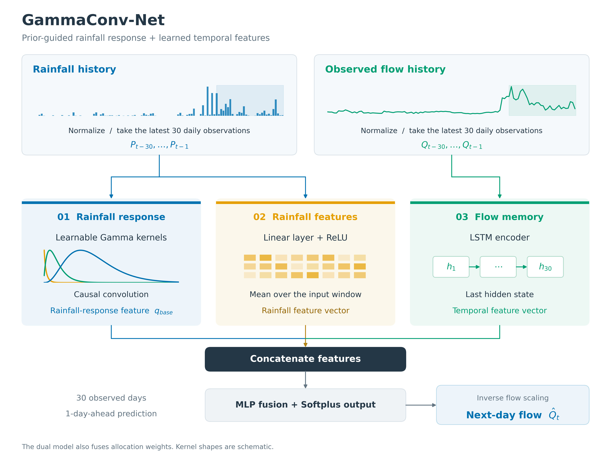
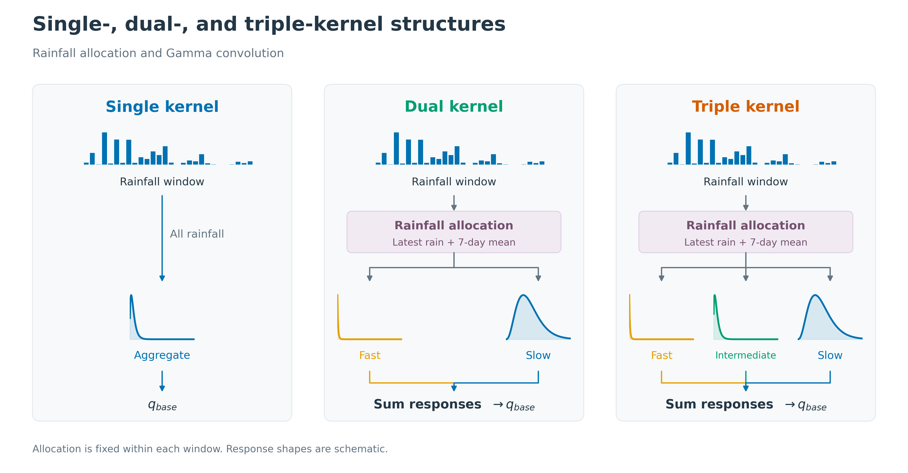
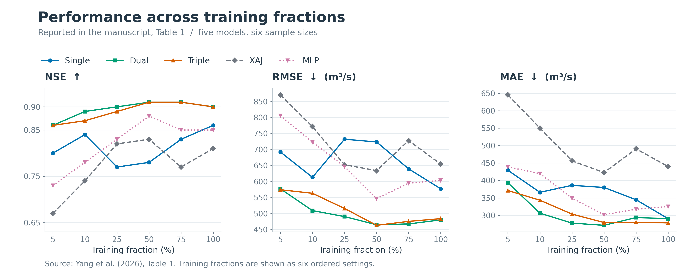
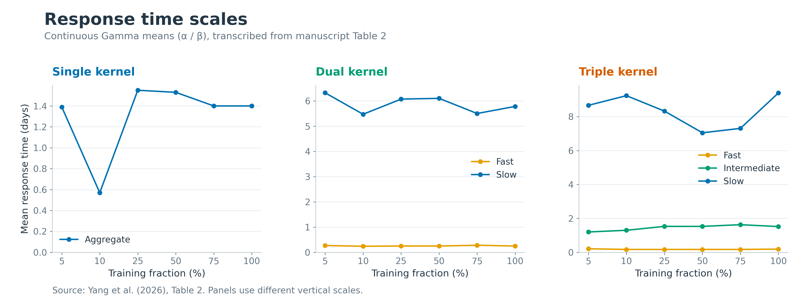
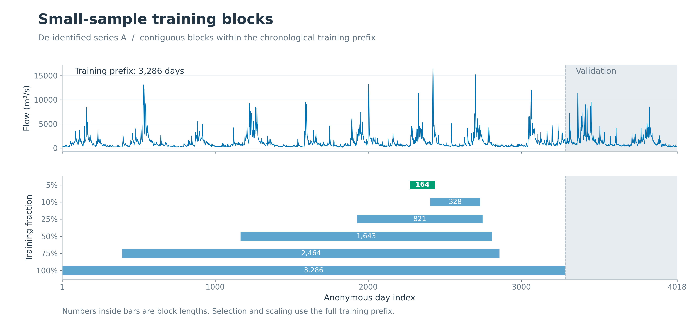
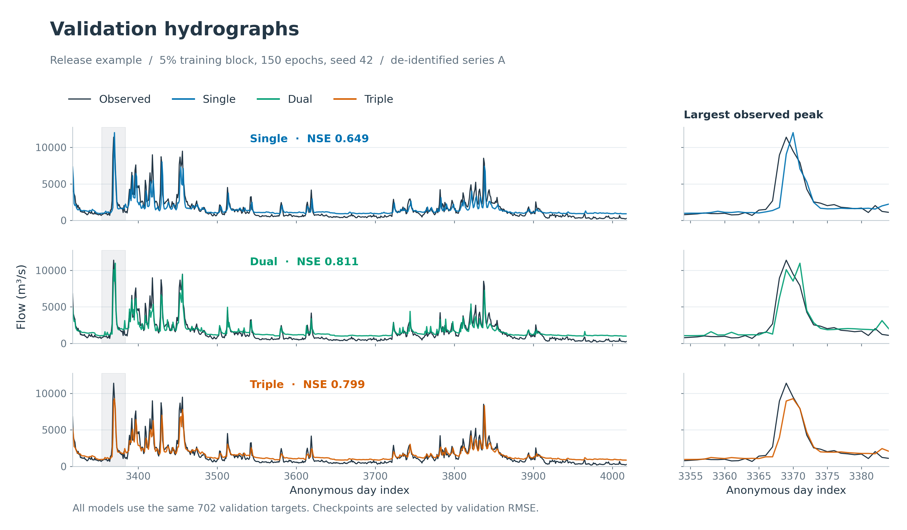
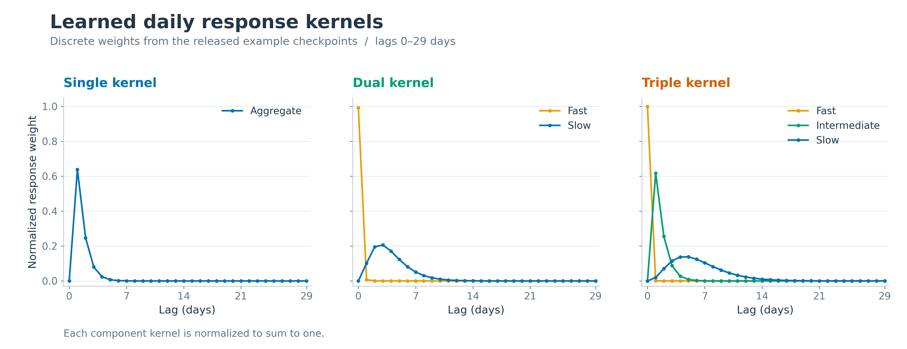
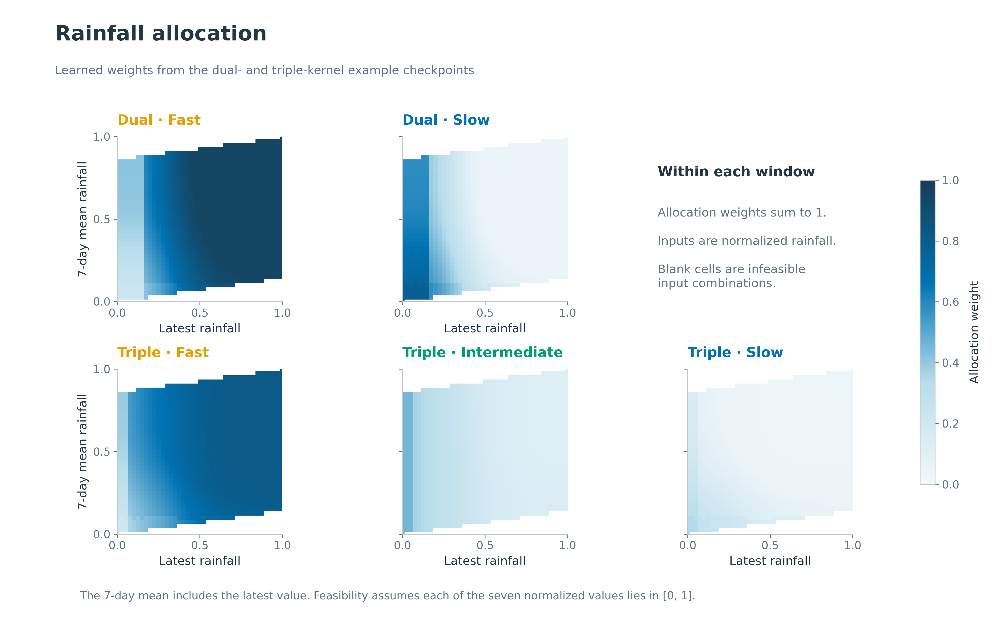

# GammaConv-Net

[](https://github.com/shawny1b0609/gammaConv-net/actions/workflows/tests.yml)

**Hydrological modeling with prior information and deep learning under small-sample conditions.**

GammaConv-Net combines learnable Gamma rainfall–runoff responses, rainfall features, and an LSTM representation of observed flow to predict flow one day ahead. Single-, dual-, and triple-kernel variants describe different response time scales.

This repository provides the research models, training and inference tools, fitted examples, and an English [paper overview](docs/paper.md). The scientific description follows [Yang et al. (2026)](https://doi.org/10.14042/j.cnki.32.1309.2026.04.002).

**Data.** The supplied series are de-identified demonstration data and do not represent any particular basin. Dates and identifiers have been removed; rainfall and flow values, their order, and daily spacing are preserved. [Data documentation](data/README.md).

## Model structure



*Architecture adapted from manuscript Figure 1. The released models use 30 observed days to predict the next day.*



*Kernel structures adapted from manuscript Figure 2. Fast, intermediate, and slow denote learned response components.*

| Variant | Response components | Implementation |
| --- | --- | --- |
| Single | Aggregate | [Single-kernel model](physics_informed/simplified_physics_model.py) |
| Dual | Fast and slow | [Dual-kernel model](physics_informed/dual_kernel_model.py) |
| Triple | Fast, intermediate, and slow | [Triple-kernel model](physics_informed/improved_water_balanced_kernel.py) |

[Implementation notes](docs/method.md) describe kernel discretization, rainfall allocation, and the training protocol.

## Paper results



*Manuscript Table 1. At the 5% training fraction, the dual- and triple-kernel models achieve NSE 0.86; Xin'anjiang (XAJ) and MLP achieve 0.67 and 0.73.*



*Manuscript Table 2. The continuous Gamma mean, α/β, summarizes each component's response time scale.*

## Run the code

Use Python 3.11 or 3.12 with the tested dependencies:

```bash
git clone https://github.com/shawny1b0609/gammaConv-net.git
cd gammaConv-net
python -m venv .venv
```

Activate with `source .venv/bin/activate` on Linux/macOS or `.venv\Scripts\Activate.ps1` in Windows PowerShell, then install:

```bash
python -m pip install -r requirements.txt
python -m pip install -e . --no-deps
python -m unittest discover -s tests -v
```

Check training and prediction with a short CPU run:

```bash
python -m gammaconv.train --model dual --fraction 0.05 --epochs 3 --hidden 16 --out runs/quick
python -m gammaconv.predict --checkpoint runs/quick/model.pt --data data/series_a.csv --out runs/quick/rolling.csv
```

Commands default to CPU. Use `--device cuda` with a compatible PyTorch installation. For notebook use, install `python -m pip install -e ".[notebook]"` and open [the walkthrough](examples/walkthrough.ipynb).

Each run saves the selected checkpoint, predictions, training history, and a `run.json` record of the settings, data split, scaler, and metrics.

## Example results

The following figures use de-identified series A and the 150-epoch examples supplied with [release v0.1.0](https://github.com/shawny1b0609/gammaConv-net/releases/tag/v0.1.0). Checkpoints are selected by validation RMSE; reported scores describe validation performance. Settings and checks are recorded in [release validation](docs/validation.md).

```bash
python -m gammaconv.experiment --fractions 0.05 --epochs 150 --out runs/example
```



*Sampling across six fractions. The 5% example uses 164 consecutive days, yielding 134 training windows. Block selection and scaling use the complete training prefix.*



*Validation hydrographs and a 31-day view around the largest observed peak.*



*Fitted daily response weights, including the lag-zero response.*



*Component allocation as a function of the latest rainfall and its seven-day mean.*

To use the fitted weights, extract the [checkpoint archive](https://github.com/shawny1b0609/gammaConv-net/releases/tag/v0.1.0) into the repository:

```bash
python -m gammaconv.predict --checkpoint checkpoints/dual/model.pt --data data/series_a.csv --out runs/loaded.csv
```

All eight figures have [PNG, SVG, and PDF versions](docs/figures/README.md), with [source tables](docs/figure_data/README.md). Regenerate them with:

```bash
python examples/make_readme_figures.py
```

For the full six-fraction preset, run `python -m gammaconv.experiment --out runs/full`. It fits all three variants at each fraction, for up to 2,500 epochs per fit. See the [experiment protocol](docs/method.md#training-and-evaluation).

## Citation and permissions

Yang, Y., Zhang, J., Liu, J., and Jiang, K. (2026). *Hydrological modeling with priors information and deep learning under small-sample conditions*. Advances in Water Science, 37(4), 607–618. [doi:10.14042/j.cnki.32.1309.2026.04.002](https://doi.org/10.14042/j.cnki.32.1309.2026.04.002). In Chinese: 融合先验信息与深度学习的小样本水文建模.

[Journal article](https://skxjz.nhri.cn/article/doi/10.14042/j.cnki.32.1309.2026.04.002) · [Institutional abstract](https://www.nhri.cn/xsjl/art/2026/art_01153cb27bf047df949ebc1c4c8aaa03.html) · [English bibliographic record](https://agris.fao.org/search/en/providers/122436/records/6a96d36d8a202ccda1b650c8) · [Access checks](docs/paper_access.md)

Copyright © 2026 Yibo Yang. This source-available project uses the [Noncommercial Research License](LICENSE). Commercial use requires prior written permission. The paper and third-party dependencies retain their own rights and licenses. Citation metadata: [CITATION.cff](CITATION.cff).
