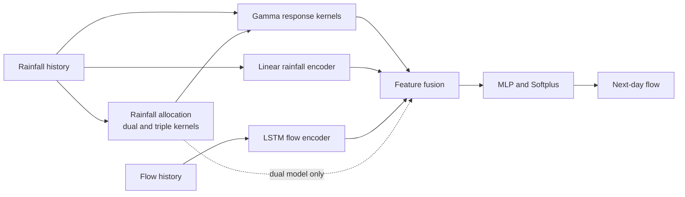
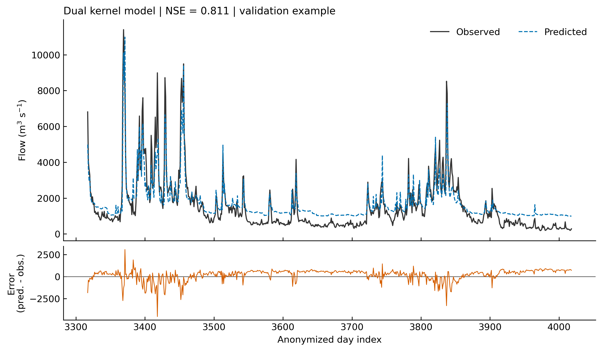

# GammaConv-Net

[](https://github.com/shawny1b0609/gammaConv-net/actions/workflows/tests.yml)

**Hydrological modeling with prior information and deep learning under small-sample conditions.**

GammaConv-Net uses learnable Gamma response kernels to describe the time lag between rainfall and runoff. Rainfall features and an LSTM representation of recent flow are combined with this response to predict flow one day ahead. Single-, dual-, and triple-kernel variants represent different levels of runoff-component separation.

This repository contains the research model implementations, training and inference tools, and an English walkthrough. The scientific overview follows the author's revised manuscript of [Yang et al. (2026)](https://doi.org/10.14042/j.cnki.32.1309.2026.04.002). See the [paper overview](docs/paper.md) and [implementation notes](docs/method.md).

**Data notice.** The included CSV files are de-identified demonstration data and do not represent any particular basin. Calendar dates and identifiers have been removed. Rainfall and flow values, their order, and daily spacing are preserved. See [data documentation](data/README.md).

## Model structure



| Variant | Response components | Code |
| --- | --- | --- |
| Single | One aggregate response | [Single-kernel model](physics_informed/simplified_physics_model.py) |
| Dual | Fast and slow responses | [Dual-kernel model](physics_informed/dual_kernel_model.py) |
| Triple | Fast, intermediate, and slow responses | [Triple-kernel model](physics_informed/improved_water_balanced_kernel.py) |

The component labels follow the hydrological interpretation in the paper. They are learned response components, rather than separately measured flow series.

## Run the code

Use Python 3.11 or 3.12 for the tested dependency versions. From the repository root:

```bash
git clone https://github.com/shawny1b0609/gammaConv-net.git
cd gammaConv-net
python -m venv .venv
```

Activate with `source .venv/bin/activate` on Linux/macOS or `.venv\Scripts\Activate.ps1` in Windows PowerShell, then install:

```bash
python -m pip install -r requirements.txt
python -m pip install -e . --no-deps
python -m unittest discover -s tests -v
```

A short CPU run checks the complete training and prediction path:

```bash
python -m gammaconv.train --model dual --fraction 0.05 --epochs 3 --hidden 16 --out runs/quick
python -m gammaconv.predict --checkpoint runs/quick/model.pt --data data/series_a.csv --out runs/quick/rolling.csv
```

Three epochs are a functional check, not a fitted research result. For a longer example using the original small-sample experiment settings:

```bash
python -m gammaconv.experiment --fractions 0.05 --epochs 150 --out runs/example
python -m gammaconv.plot --run runs/example/0.05/dual --out runs/example/figures
```

Use `--device cuda` with a compatible PyTorch CUDA installation. All commands default to CPU. For notebook use, install `python -m pip install -e ".[notebook]"` and open [the walkthrough](examples/walkthrough.ipynb).

Each training run saves `model.pt`, `predictions.csv`, `history.csv`, and `run.json`. The last file records the configuration, split, scaler, data checksum, environment, fitted kernel parameters, and validation metrics. The checkpoint contains the best validation weights and its fitted scaler.

## Example output



The figure is from the 150-epoch dual-kernel example above, with a 5% contiguous training block and seed 42. It uses the checkpoint selected by validation error. These are example validation results, not an independent test or a reproduction of the paper's reported scores. [Run records and metrics](docs/validation.md) provide the settings for all three variants.

## Research experiments

The original experiment covers training fractions of 5%, 10%, 25%, 50%, 75%, and 100%. The full preset can be run with:

```bash
python -m gammaconv.experiment --out runs/full
```

It runs 18 fits, with up to 2,500 epochs per fit. The selection rule searches the complete training prefix for a continuous high-flow period; scaling also uses that prefix. A 5% setting therefore limits the fitted window sequence, not all information available during sample selection. Validation data are excluded from selection and scaling. See [the experiment protocol](docs/method.md#training-and-evaluation).

## Citation and permissions

Yang, Y., Zhang, J., Liu, J., and Jiang, K. (2026). *Hydrological modeling with priors information and deep learning under small-sample conditions*. Advances in Water Science, 37(4), 607–618. [doi:10.14042/j.cnki.32.1309.2026.04.002](https://doi.org/10.14042/j.cnki.32.1309.2026.04.002). In Chinese: 融合先验信息与深度学习的小样本水文建模.

[Journal article](https://skxjz.nhri.cn/article/doi/10.14042/j.cnki.32.1309.2026.04.002) · [Institutional abstract](https://www.nhri.cn/xsjl/art/2026/art_01153cb27bf047df949ebc1c4c8aaa03.html) · [English bibliographic record](https://agris.fao.org/search/en/providers/122436/records/6a96d36d8a202ccda1b650c8) · [Access checks](docs/paper_access.md)

Copyright © 2026 Yibo Yang. Code, documentation, and example data are available under the [Noncommercial Research License](LICENSE). Commercial use requires prior written permission. This is a source-available research project; its license is not an OSI-approved open-source license. The paper and third-party dependencies retain their own rights and licenses. Citation metadata are in [CITATION.cff](CITATION.cff).
