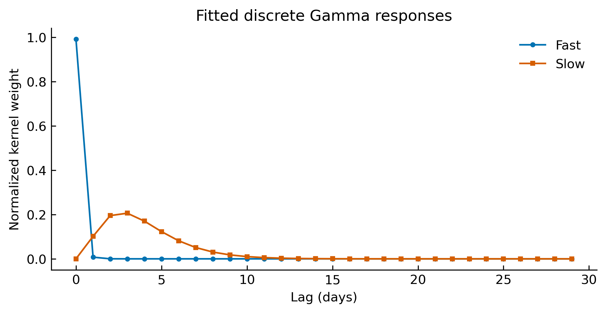
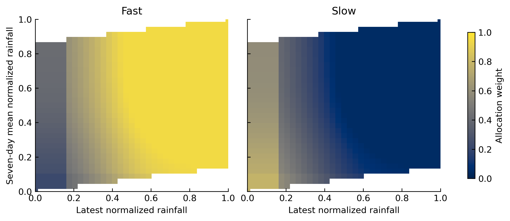

# Implementation notes

The scientific overview in [paper.md](paper.md) follows the manuscript. This page describes the executable research code, including details needed to interpret its outputs.

## Inputs and prediction

The three main models take rainfall and flow tensors of shape `(batch, steps, 1)`. The supplied runner uses 30 observed days to predict next-day flow. Validation follows the same one-day-ahead protocol, with observed flow in each input window. Complete windows are required; `flow_mask` is retained as an unused compatibility argument.

Rainfall and flow are scaled separately with minima and maxima from the chronological training prefix. Validation values may fall outside `[0, 1]` and are not clipped. The final Softplus layer produces a nonnegative prediction on the normalized scale; the saved flow scaler converts it back to the supplied units.

## Gamma response

The code evaluates a finite sequence of weights at integer lags:

$$
g_j = \frac{(j+10^{-6})^{\alpha-1}\exp(-\beta j)}
{\sum_{i=0}^{L-1}(i+10^{-6})^{\alpha-1}\exp(-\beta i)+10^{-8}},
\qquad j=0,\ldots,L-1.
$$

The common density prefactor cancels under normalization. Parameters are clamped to component-specific bounds, then learned together with the network weights. The implementation uses a reversed kernel in `conv1d` and crops the padded output to the input length. This gives a causal convolution for a fixed kernel.

The density and code use `exp(-βt)`, making β the **rate** parameter. The manuscript labels it a scale parameter. The continuous Gamma mean is `α/β`; the finite discrete mean lag is `sum(j * g_j)`. Discretization can produce substantial differences, especially for α below one, when the lag-zero term dominates.

Fitted weights from the saved dual-model example, including lag zero. The [three-model comparison](figures/model_kernels.png) shows all variants.

## Multiple responses

The dual model has fast and slow kernels; the triple model adds an intermediate kernel. Allocation depends on the last rainfall value in the input window and the mean of up to the last seven values. The mean includes the latest observation. Each window receives one allocation vector, held fixed across that window.

Base and intensity weights are normalized with softmax. Sigmoid factors, together with the original conditional branches, adjust the allocation according to rainfall intensity and antecedent rainfall. The adjusted values are clipped to `[0.05, 0.9]` and renormalized. All kernels use the allocated rainfall, and their responses are summed. The dual model also passes its allocation weights to the feature-fusion network.

Blank regions are infeasible combinations when each normalized rainfall input lies in `[0, 1]`. The component labels express the intended hydrological interpretation; supervision uses observed total flow.

Normalization constrains component allocation and kernel sums. Cropping truncates the response tail outside the window. Final flow is learned through the fusion network without a catchment-scale water-balance constraint.

## Training and evaluation

The split is chronological: `floor(0.818 * number_of_rows)` records form the training prefix; the remainder forms the validation suffix. Windows are made separately within each part, so the first 30 validation records provide history and are not validation targets. For `series_a.csv`, this gives 3,286 training-prefix records and 702 validation targets.

For a fraction below one, the experiment searches every contiguous block of the requested length within the training prefix. Its score emphasizes high flow: the maximum and 90th percentile for fractions up to 10%, with mean, variability, and range terms added at larger fractions. The fraction limits the fitted windows; block selection and scaling use the full training prefix.

Two original training paths are retained:

| Entry point | Loss and optimizer |
| --- | --- |
| `gammaconv.train` | Sample-size-dependent high-, middle-, and low-flow weights; AdamW; cosine learning-rate decay; gradient clipping |
| `gammaconv.experiment` | Sum of weighted mean squared errors in three batch-relative flow bands; AdamW with a fixed learning rate; original fraction-dependent hyperparameters |

The experiment uses the batch 80th and 30th percentiles to form high- and low-flow groups. Hyperparameters are in [experiment.py](../gammaconv/experiment.py). The scripts retain the original code's losses, which differ from the 85th-percentile weighting expression in manuscript Equation 12.

Validation is checked after every epoch. The checkpoint with the lowest validation RMSE is copied and restored; on fixed nonconstant targets this also maximizes NSE. Early stopping uses the configured patience. For constant targets, NSE is recorded as JSON `null` and selection uses RMSE. Reported scores describe the validation sequence used for checkpoint selection.

## Reproducibility and scope

The runner records seeds, dependency versions, data checksum, scaling parameters, and selected day indices. CPU is the default. Fixed seeds support repeatability within an environment; results may vary across PyTorch versions and processing backends.

The three experiment architectures and all original standalone model/loss modules are included. `hydrological_model.py` retains an earlier correction-based architecture with some unused modules. The notebook workflows are consolidated into an English walkthrough and shared training/plotting functions.

The release adds input validation, portable paths, saved run records, checkpoint inference, and automated checks. It fixes CPU checkpoint aliasing and restores the best training checkpoint. Model calculations, component bounds, and block selection remain unchanged. Executable experiments cover the three GammaConv-Net variants; XAJ and MLP results are supplied as cited manuscript tables.
